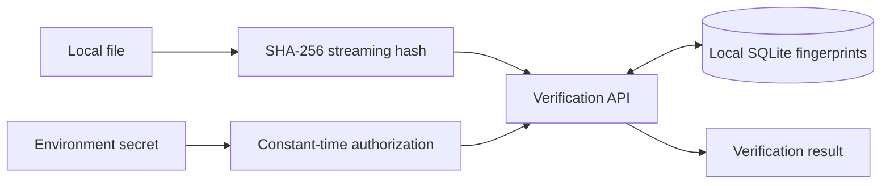
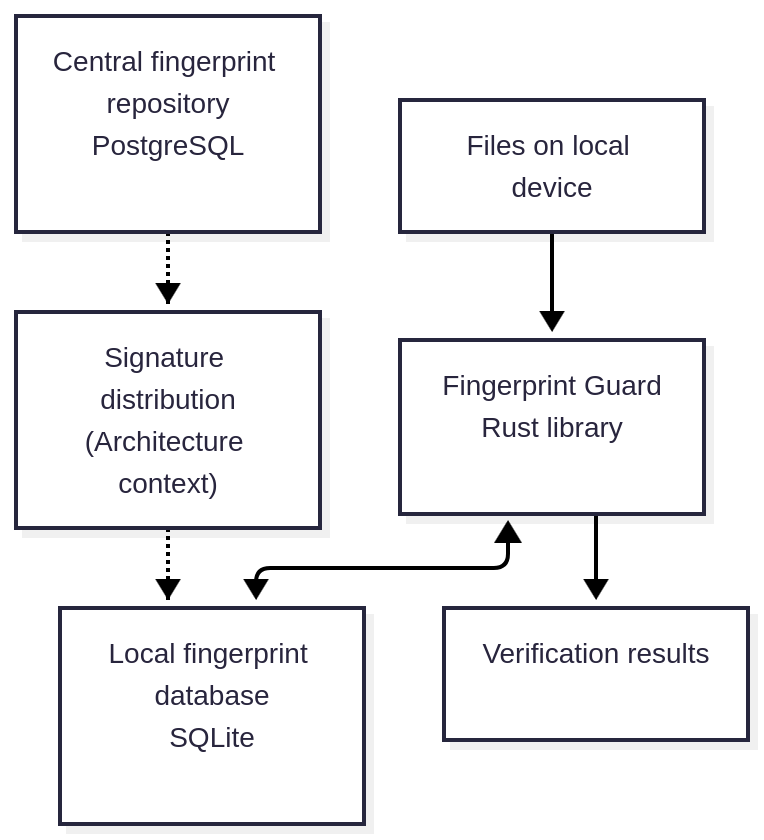
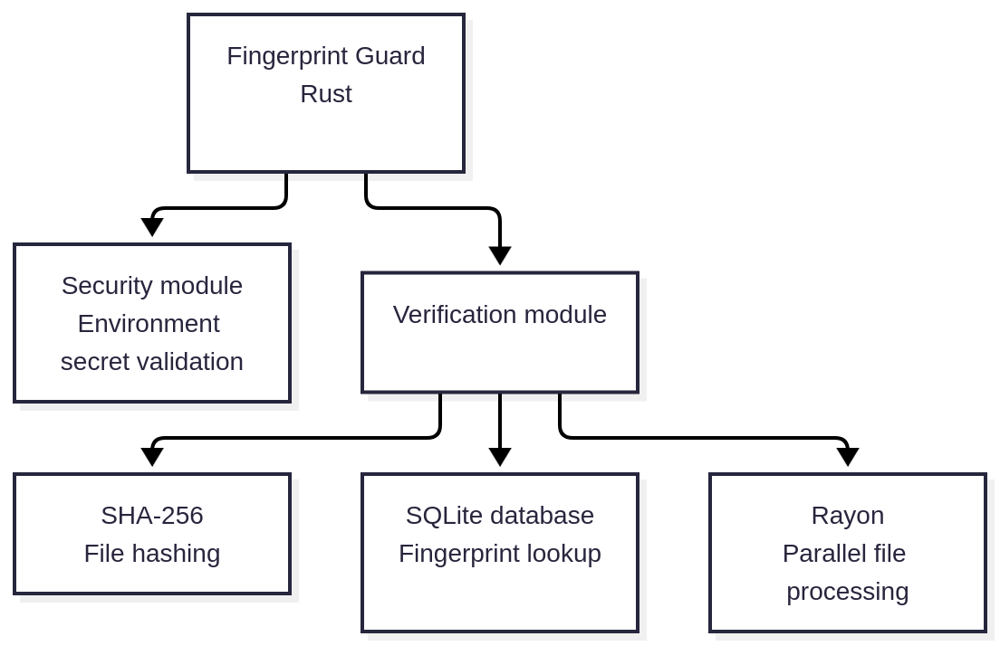
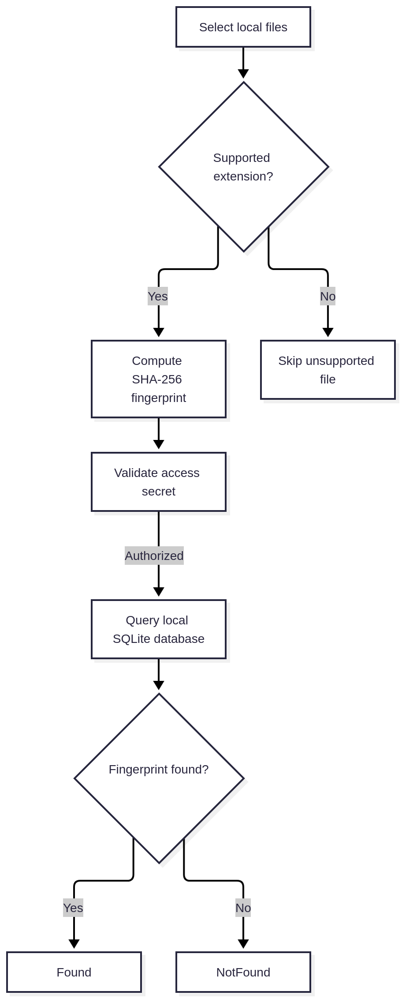

# Fingerprint Guard

**Secure local file fingerprint verification in Rust**

A small Rust library and demonstration CLI that checks file fingerprints against a local SQLite store. It explores how endpoint-side fingerprint checks can reduce redundant processing while keeping file contents local.

**Technologies:** Rust · SHA-256 · SQLite (`rusqlite`) · Rayon · constant-time comparison (`subtle`)

## Background

In distributed endpoint-security architectures, devices may need to check local files against known fingerprints without uploading the original documents. A broader design can involve a central signature repository and synchronization to local stores. **This repository implements the local verification component only**; it does not include the central platform or synchronization service.

## My contribution

- Implemented a reusable Rust library for fingerprint lookup in SQLite.
- Added access validation against `FINGERPRINT_GUARD_SECRET`, using a constant-time byte comparison.
- Implemented streaming SHA-256 hashing using 8 KiB chunks to avoid loading entire files into memory.
- Added Rayon-based parallel processing and extension filtering for `.pdf`, `.docx`, `.txt`, `.dcm`, `.csv`, `.json`, and `.xml`.
- Exposed distinct results for known/unknown fingerprints, unauthorized access, database failures, and file I/O failures.
- Added a demonstration CLI and unit tests.

## Architecture

See the [architecture diagram](docs/architecture.md) for the boundary between the **implemented local library** and the **conceptual distributed system**.



### Technical Diagrams

The following diagrams illustrate the overall system concept, the implemented Rust library, and the local fingerprint verification process.

#### 1. System Architecture

High-level overview of the distributed fingerprint verification concept.



#### 2. Fingerprint Guard Architecture

Internal architecture of the implemented Rust fingerprint verification library.



#### 3. Verification Workflow

Overview of the local file fingerprint verification process.




## Repository layout

```text
.
├── src/
│   ├── lib.rs        # Public library interface
│   ├── db.rs         # SQLite fingerprint store
│   ├── security.rs   # Secret validation
│   ├── verify.rs     # Hashing, filtering, parallel verification, tests
│   └── main.rs       # Demonstration CLI
├── docs/
│   ├── architecture.md
│   └── diagrams/
│       ├── system-architecture.png
│       ├── fingerprint-guard-architecture.png
│       └── verification-workflow.png
├── Cargo.toml
├── Cargo.lock
├── README.md
└── .gitignore
```

## Getting started

Requires a working Rust toolchain (`cargo`) and SQLite development support as needed by `rusqlite`.

```bash
git clone <git clone git@github.com:lydiaabdelhamid05-ux/Fingerprint-Guard.git>
cd Fingerprint-Guard
cargo build
cargo test
```

To run the demonstration CLI:

```bash
export FINGERPRINT_GUARD_SECRET='replace-with-a-local-test-secret'
export DB_PATH='fingerprints.db'
cargo run
```

The demo contains **illustrative file paths**. Missing sample files produce I/O errors; add your own local test files to exercise file hashing. The SQLite database is created on first use. It starts without known fingerprints, so lookups normally return `NOT_FOUND` until fingerprints are inserted.

### Library usage

```rust
use fingerprint_guard::{verify, VerifyResult};

let result = verify("example-sha256-hex", "your-test-secret", "fingerprints.db");
match result {
    VerifyResult::Found => println!("Known fingerprint"),
    VerifyResult::NotFound => println!("Unknown fingerprint"),
    VerifyResult::Unauthorized => println!("Access denied"),
    VerifyResult::DatabaseError(err) => eprintln!("Database error: {err}"),
    VerifyResult::IoError(err) => eprintln!("File error: {err}"),
}
```

`verify_files` accepts a slice of file paths and hashes supported file types in parallel.

## Security considerations and limitations

- **Authorization:** a shared environment secret is compared in constant time. This is a prototype-level control, not a complete endpoint identity or credential-management system.
- **Hashing:** SHA-256 is used for local fingerprint comparison; this is **not** malware classification or automatic threat neutralization.
- **Database encryption:** `DB_ENCRYPTION_KEY` is passed as an SQLite `key` pragma when present. **Encryption is not guaranteed by the default build**; it requires SQLCipher-enabled SQLite, which this repository does not configure or verify. Do not store sensitive data assuming encryption is active.
- **Database initialization:** the local SQLite database and `fingerprints` table are created automatically. There is no bundled central signature feed or ingestion pipeline.
- **Scope:** PostgreSQL synchronization, delta distribution, Merkle proofs, per-device salting, and cross-platform credential storage are architectural ideas or future work, **not implemented features in this repository**.
- **Tests:** unit tests are included; no performance or security certification is claimed.

## Development status

Educational/portfolio prototype of the local verification component. It is not a production endpoint protection agent.

## Publication note

Prepared as a minimal technical portfolio example. **Do not publish code derived from an internship or employer project without the appropriate authorization.** No internal diagrams, poster, organization-specific configuration, credentials, or personal documentation are included.
