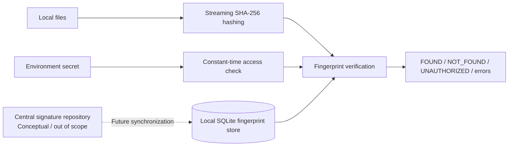

# Architecture overview

This diagram is a **conceptual overview**, not evidence of an implemented synchronization service. The published code covers only the local Rust library and CLI.

## Implemented scope
- Local SHA-256 hashing of supported files, in 8 KiB chunks.
- Rayon parallel processing of a list of paths.
- Access check against an environment variable before database lookup.
- SQLite fingerprint existence checks with explicit database and I/O error variants.

## Outside the published implementation
- PostgreSQL synchronization, message transport, Merkle tree generation, per-device salting, and cloud infrastructure.
- Encrypted SQLite requires an actual SQLCipher-enabled SQLite build; the included Cargo manifest does not configure SQLCipher.
